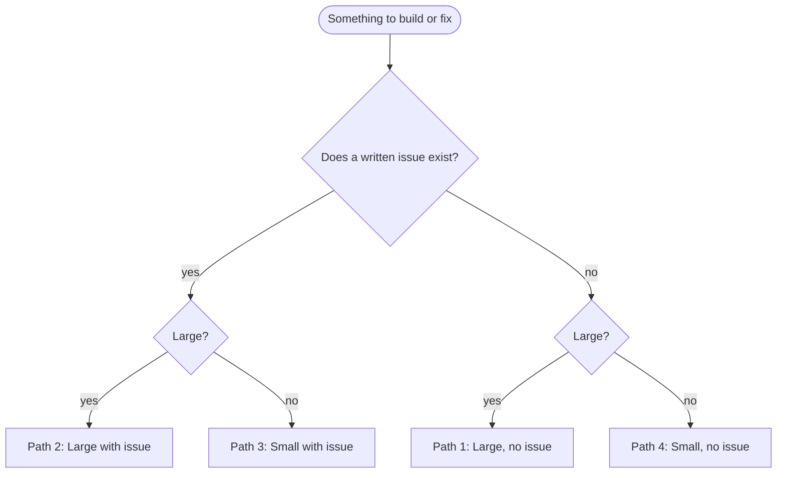
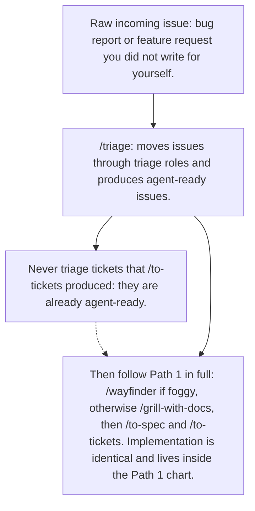
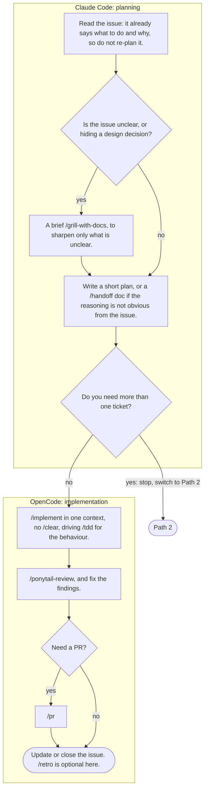
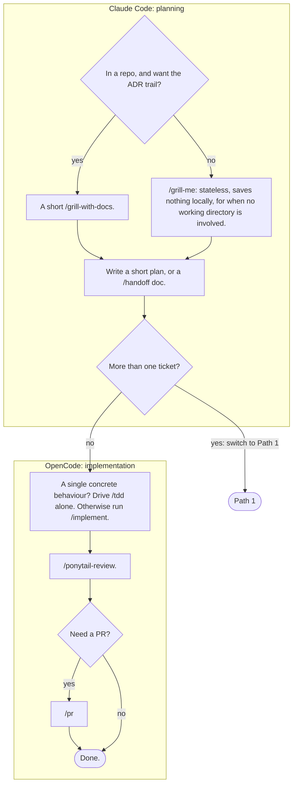
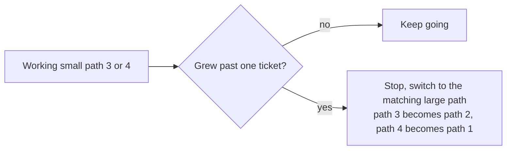
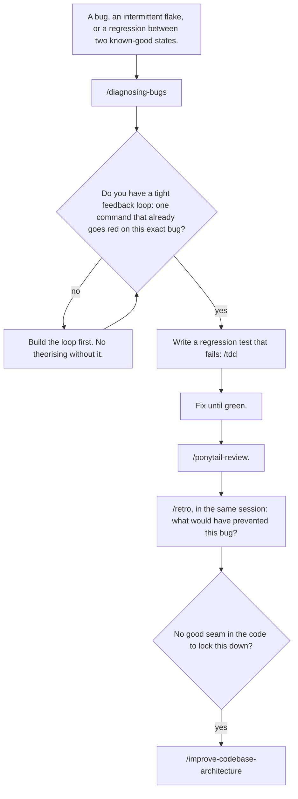
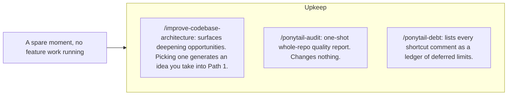
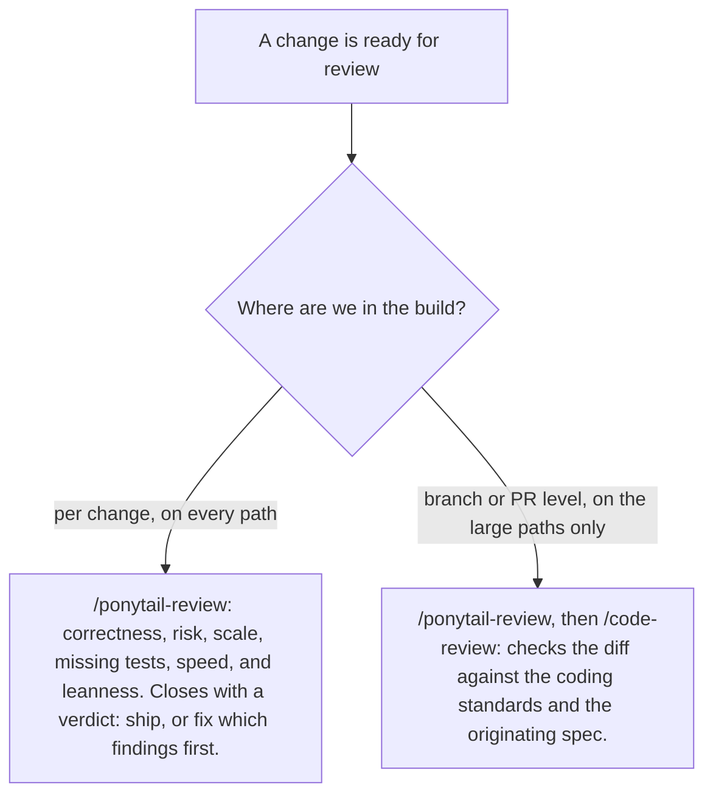
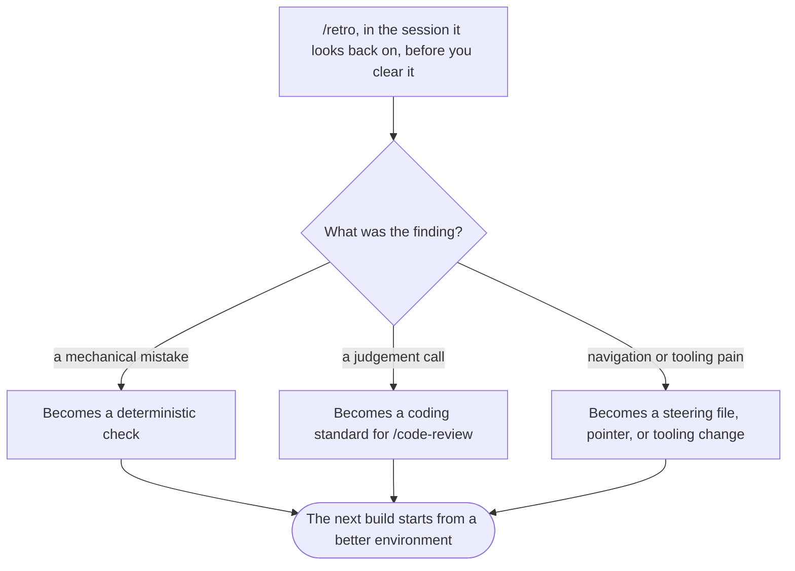

# Workflow

The rule is simple: **Claude Code plans, OpenCode implements.** Never build in Claude Code, never plan a big feature in OpenCode. The bridge between the two windows is the ticket list on the issue tracker (source of truth) plus a `/handoff` doc that captures session context which specs and ADRs do not already record.

## One-time setup

- [ ] Run `/setup-matt-pocock-skills` in Claude Code. The "with issue" paths assume whatever tracker this configures (GitHub Issues or local `.scratch/` files). Until this is done, only work the two "no issue" paths.

## Which path am I on?

Two questions decide everything: does a written issue exist, and is the job large?

| Issue exists? | Large? | Path |
|---|---|---|
| No  | Yes | [Path 1: Large, no issue](#path-1-large-no-issue) |
| Yes | Yes | [Path 2: Large, with issue](#path-2-large-with-issue) |
| Yes | No  | [Path 3: Small, with issue](#path-3-small-with-issue) |
| No  | No  | [Path 4: Small, no issue](#path-4-small-no-issue) |

**Large** means more than one ticket, or more than one session of work. **Small** means one ticket, one session.

## Path 1: Large, no issue

```mermaid
flowchart TD
    subgraph CC ["Claude Code: planning"]
        ENTRY{"Foggy, greenfield, or too big for one session?"} -- yes --> WF["/wayfinder: charts decision tickets on the tracker and resolves them one at a time, producing decisions, not deliverables. Never for a well-scoped feature."]
        ENTRY -- no --> GRILL
        WF -->|"when the way is clear: it hands off, it does not build"| GRILL["/grill-with-docs: interviews you until the idea is sharp, and leaves a paper trail: GLOSSARY.md and ADRs."]
        GRILL --> PROTO{"Does a design question need code to answer?"} -- "yes: state, business logic, or a UI to see" --> HP["/handoff out, open a fresh session in a separate directory, run /prototype, then /handoff back what you learned, and reference it from the original thread."]
        PROTO -- "no" --> SPEC["/to-spec: turns the conversation into a spec."]
        HP --> SPEC
        SPEC --> TICKETS["/to-tickets: splits the spec into tracer-bullet tickets, each declaring its blocking edges."]
        TICKETS --> HYG["Context hygiene: keep planning in one unbroken context window. Do not compact or clear until after /to-tickets. Near the smart zone of roughly 150k tokens, /compact at the nearest phase boundary."]
    end
    HYG --> BRIDGE
    subgraph OC ["OpenCode: implementation"]
        BRIDGE["The tickets are the source of truth, so OpenCode reads tickets, not a summary. Write a /handoff doc only for session context not already captured in specs, ADRs, or tickets, and reference those by path."] --> IMPL["Pick any ticket whose blockers are done. Run /implement on it with the review override in your prompt: finish with /ponytail-review instead of /code-review. It uses /tdd where possible at pre-agreed seams, typechecks regularly, runs the full test suite once at the finish, and commits to the current branch."]
        IMPL --> REVIEW["/ponytail-review after each change. Fix the findings before the next ticket."]
        REVIEW --> DONE{"All tickets done?"}
        DONE -->|"not yet"| CLEAR["/clear, then pick the next ticket. Each ticket is self-contained."]
        CLEAR --> IMPL
        DONE -- yes --> FINAL["/ponytail-review over the branch"] --> CODE["/code-review: checks the diff against coding standards and the originating spec."] --> PRB["/pr: the smallest visual that shows the change, before and after evidence it works, and a one-way or two-way door call."] --> RETRO["/retro: turns every finding into an environment change, a coding standard, an automated check, or a steering file."]
        ALT["Alternative: instead of driving tickets by hand, /implement-spec builds the whole spec in one orchestrated run, with implementer subagents working the ready frontier in parallel onto one integration branch."] -.->|"if you would rather orchestrate"| IMPL
    end
```

## Path 2: Large, with issue

## Path 3: Small, with issue

## Path 4: Small, no issue

## Escalation

## Bugs: something broken, throwing, or slow

## Upkeep

## The review rule

## The retro loop

